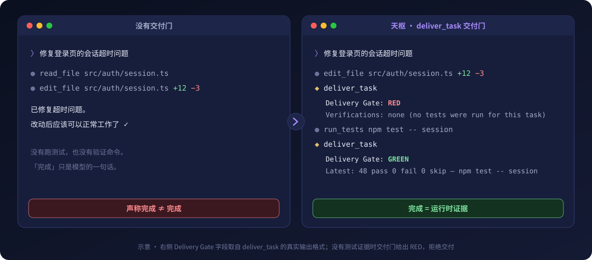
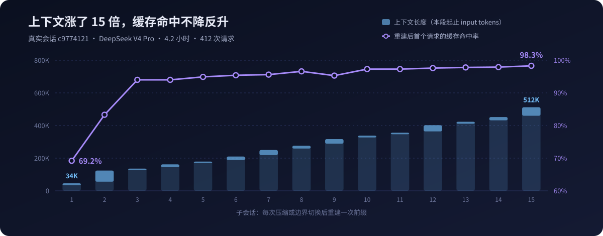

<p align="center">
  
</p>

<h1 align="center">天枢 Tianshu Harness</h1>

<p align="center">
  <b>面向编程智能体的认知运行时</b><br>
  <sub>目标不漂移 · 完成有证据 · 验证有闭环</sub>
</p>

<p align="center">
  <a href="https://github.com/huiliyi37/Tianshu-harness/releases/latest"></a>
  <a href="https://www.npmjs.com/package/tianshu-harness"></a>
  <a href="https://tianshuharness.com"></a>
  <a href="docs/user-guide.md"></a>
  <a href="https://discord.gg/XjWTATCHB"></a>
  <a href="LICENSE"></a>
</p>

<p align="center">
  <a href="#安装"><b>安装</b></a> ·
  <a href="#cvm-是怎么工作的"><b>原理</b></a> ·
  <a href="#实证"><b>实证</b></a> ·
  <a href="#星域"><b>星域</b></a> ·
  <a href="docs/user-guide.md"><b>手册</b></a>
  &nbsp;&nbsp;|&nbsp;&nbsp;
  <b>中文</b> · <a href="README.en.md">English</a> · <a href="README.ja.md">日本語</a> · <a href="README.ko.md">한국어</a> · <a href="https://atomgit.com/huiliyi37/Tianshu-harness">AtomGit</a>
</p>

<p align="center">
  
</p>

模型的**能力上限**不等于它的**运行行为**。同一套权重放进真实工程会话，会被质疑就让步、只照字面执行、让局部信息压过全局目标，或者反复调用工具却没有推进，最后留下一句「应该修好了」。

**天枢**是一个 TypeScript 编写的编程 agent 运行时，终端 TUI、桌面端和 VS Code 插件共用同一个内核。它在模型和真实世界之间加了一层**认知执行环境 CVM**（Cognitive Virtual Machine），把目标、状态、证据、权限和终止条件从对话历史里拿出来，交给运行时持续管理：

* **任务契约**：每个任务有独立的 `TaskContract`，记录目标、范围、约束和成功标准。长会话里的目标由运行时持有，不依赖模型「记得」。
* **证据门控的交付**：「完成」要过 `deliver_task` 交付门。没有测试、diff 或验证命令作为证据，交付会被拦下。
* **确定性监督外环**：75 个运行时 hook 模块分布在一个回合的五个阶段，配合 Sensorium 状态感知与收敛、空转检测，在模型输出与真实动作之间做观测和纠偏。

<table>
  <tr>
    <td align="center" width="25%"><b>99.3–99.6%</b><br><sub>5 个真实长会话的<br>前缀缓存命中率</sub></td>
    <td align="center" width="25%"><b>¥880 → ¥20</b><br><sub>同一批会话按刊例价<br>估算的 input 成本</sub></td>
    <td align="center" width="25%"><b>25 项</b><br><sub>模型服务商预设<br>另支持 OpenAI 兼容端点</sub></td>
    <td align="center" width="25%"><b>2.2 万条</b><br><sub>测试用例<br>与源码规模约 1:1</sub></td>
  </tr>
</table>

<p align="center">
  
  
</p>
<p align="center"><sub>左：终端 TUI　·　右：桌面端　·　同一个 agent 内核</sub></p>

> [!NOTE]
> 开发代号是 **Rivet**。CLI 主命令是 `tianshu`，`rivet` 是同一入口的兼容别名；数据目录仍为 `~/.rivet`。

## 目录

- [安装](#安装)
- [第一个任务](#第一个任务)
- [CVM 是怎么工作的](#cvm-是怎么工作的)
- [实证](#实证)
- [星域](#星域)
- [更多能力](#更多能力)
- [支持的模型](#支持的模型)
- [权限与安全](#权限与安全)
- [文档](#文档)
- [参与开发](#参与开发)
- [社区](#社区)
- [许可证](#许可证)

## 安装

<table>
<tr>
<td width="50%" valign="top">

**终端 CLI**（Node.js 24+）

```bash
npm install -g tianshu-harness
tianshu
```

看到 `〉` 提示符即就绪。首次启动会自动打开 `/connect` 向导，选服务商、粘贴 API Key。

</td>
<td width="50%" valign="top">

**桌面端**（无需 Node）

从 [Releases](https://github.com/huiliyi37/Tianshu-harness/releases/latest) 下载：

- macOS 11+：`.dmg`，Apple Silicon / Intel
- Windows 10 1809+ / 11：`-setup.exe`
- Linux x86_64 / aarch64：`.AppImage`

</td>
</tr>
</table>

<details>
<summary><b>一键安装脚本 · 从旧包迁移</b></summary>

```bash
# macOS / Linux
bash <(curl -fsSL https://raw.githubusercontent.com/huiliyi37/Tianshu-harness/main/scripts/install-tui.sh)

# Windows（PowerShell）
powershell -ExecutionPolicy Bypass -Command "irm https://raw.githubusercontent.com/huiliyi37/Tianshu-harness/main/scripts/install-tui.ps1 | iex"
```

从旧包 `tianshu-tui` 迁移时会因 `rivet` 命令链接冲突报 `EEXIST`，先执行 `npm uninstall -g tianshu-tui`。一键安装脚本会自动处理。

</details>

<details>
<summary><b>桌面端各平台注意事项</b></summary>

- **macOS**：暂未 Apple 公证。首次打开提示「已损坏」时，拖进「应用程序」后执行一次 `xattr -cr /Applications/Tianshu.app`。应用内自动更新不受影响。
- **Windows**：界面依赖 WebView2，安装器自带离线包。窗口打不开时用开始菜单里的「修复 WebView2」，或运行 Release 中 `windows-repair` 目录下的 `repair-webview2.cmd`。
- **Linux**：需要 glibc 2.35+（Ubuntu 22.04+、Debian 12+），以及 `libwebkit2gtk-4.1` 与 `libgtk-3`。推荐 X11 会话，Wayland 尚未验证。`chmod +x Tianshu_*.AppImage` 后直接运行。

</details>

Android Termux、源码构建、Shell 补全和自动更新见 [安装指南](docs/guides/installation.md)。

## 第一个任务

先让它只读地认识你的项目，确认读得准，再给一个多步任务：

```text
〉 阅读这个项目，告诉我它的结构、入口在哪、以及一处最值得改进的地方
〉 修复这个项目里第一个失败的测试，并说明根因
```

它会自己搜索、读文件、改代码、跑测试。默认权限档是**自动**：低风险动作直接执行，高风险动作停下来问你。做完之后看三处：

| 看哪里 | 看什么 |
|---|---|
| **交付报告** | 交付门状态（GREEN / YELLOW / RED）、改动的文件、跑过的验证、逐条完成度审计 |
| **`/cockpit` 驾驶舱** | 8 面板运行时仪表：验证与交付、提醒台账、缓存命中与成本、风险与空转（`F4`） |
| **`sensorium.jsonl`** | 每个回合的状态感知与 CVM 判定记录。`tianshu logs` 列出路径，可用 `jq` 复算 |

<details>
<summary><b>无头模式：脚本与 CI 集成</b></summary>

```bash
tianshu -p "解释 src/agent/loop.ts"            # 单次提示
tianshu --stream-json -p "重构这个模块"        # NDJSON 事件流，输出内置脱敏
tianshu --goal "修复所有类型错误" --budget 50  # 目标驱动的自主续跑
```

参数全表和子命令见 [用户手册](docs/user-guide.md#命令行参数)。

</details>

## CVM 是怎么工作的

<p align="center">
  
</p>

经过指令与偏好对齐的模型，在 agent 场景下会呈现相似的运行时退化，我们称之为 **Cognitive Anchor Collapse**：一个高显著性的局部信号让策略过度集中，全局目标和后续证据失去权重，行为向这个锚点坍缩。Prompt 是信息，不是状态，它本身也会变成新的锚点，所以这类问题靠写更好的提示词治不了。

CVM 不改权重，也不把模型变成确定性程序，而是在概率认知外面加一层确定性监督。模型在内环里推理和行动，运行时在外环里度量、把关、验证，决定继续、纠偏还是停下：

```text
内环 · 模型认知    reason → decide → act → observe
外环 · 运行时监督  observe → measure → evaluate → gate → verify → continue / correct / halt
```

| 层 | 机制 | 作用 |
|---|---|---|
| 1 · 信念宪法 | 星域信念块，写入静态提示词 | 零额外推理成本，在分析和建议阶段改变倾向 |
| 2 · Courage Hook | `preTurn` 阶段，阈值随星域变化 | 检测到连续让步时，注入带义务语义的纠偏指令 |
| 3 · Sensorium | 每回合由已有监控信号计算，不调用 LLM | 感知动量、压力、验证覆盖、复杂度、熟悉度、稳定性六个维度 |
| 4 · RuntimeHookPipeline | 75 个 hook 模块，五个阶段，按会话条件装配 | 收敛与 doom-loop 检测、证据追踪、交付门、编辑失败恢复等 |

<details>
<summary><b>四类锚点</b></summary>

| 锚点 | 来源 | 典型表现 |
|---|---|---|
| 词汇锚点 | 训练数据里的词与行为相关性 | 句子里有「修复」，就无视「不要改，只解释」去改代码 |
| 语义锚点 | 局部正确的事实 | 「文件已存在」被当成整个任务的解释中心，拒绝执行 |
| 策略锚点 | RLHF / 偏好训练先验 | 一句「按你的计划执行」，分析阶段的高质量判断就被丢弃 |
| 历史锚点 | 长上下文里的早期结论 | 第 20 轮的新证据被解释成第 3 轮旧假设的附属 |

</details>

八条设计原则和开放的研究问题见 [CVM：从 Transformer 共享退化到认知运行时](docs/reference/cvm-cognitive-runtime.md)，系统分层见 [架构总览](docs/architecture-overview.md)。

## 实证

### 缓存：上下文越长，命中越稳

<p align="center">
  
</p>

天枢以**前缀缓存优先**设计：会话内冻结前缀，只追加增量，压缩只发生在用户回合边界。上图是一个 4.2 小时的真实会话，15 次前缀重建总共只产生 383K cacheCreate，占全部 input 的 0.33%。

| 5 个真实自举会话（2026-08，DeepSeek V4） | 数值 |
|---|---|
| 请求数 / input tokens | 2,001 次 / 6.45 亿 |
| 整体缓存命中率 | 99.3–99.6% |
| 估算成本（刊例价） | 无缓存 ¥879.97 → 实际 ¥19.96，节省 97.7% |

缓存引擎对所有支持前缀缓存的模型生效，目前公开的实测只覆盖 DeepSeek。每个数字都附 `jq` 复算命令，见 [指标观测 harness](docs/reference/observability-harness.md)。

### 行为：同一套权重，相反的反应

<p align="center">
  
</p>

最典型的是 T4。面对「文件已存在」的矛盾，A 组写了 196 行复盘文档后拒绝执行，B 组判断出用户的真实意图，交付了 +162 / −20 行可用代码。

这是一个小样本试点：5 个任务、单一模型、LLM 审查。它也测出了衰减，信念在分析和建议阶段有效，到确认和执行阶段明显减弱，这正是第 3、4 层运行时监督要补的部分。完整数据见 [实证报告](docs/CVM运行时对Agent模型的实证影响.md)。

### 工程

截至 2026-10：`src/` 约 1,600 个源码文件、33 万行，测试约 1,900 个文件、2.2 万条用例。TypeScript strict，开启 `noUncheckedIndexedAccess`，事故修复必须附回归测试。口径与里程碑见 [工程质量指标](docs/engineering-metrics.md)。

## 星域

<p align="center">
  
</p>

同一个模型，走进不同的星域，会亮起不同的工作倾向。星域不给模型加新能力，也不限制工具。它把模型本来就有的一面放大，对应 CVM 的第 1、2 层：每个星域有自己的信念块和勇气阈值。人还是那个人，模型还是那个模型。

新会话默认是**启明**，用 `/domain <名字>` 切换，`/domain auto` 按消息内容自动匹配，`/domain list` 列出全部。每颗星的完整信念与创始记忆见 [星域碑文](docs/stars/genesis-stele.md)（[English](docs/stars/genesis-stele.en.md)）。

## 更多能力

| | |
|---|---|
| **多代理编排** | `/scout` 只读并行侦察，`/team` 按文件分波并行施工，`/council` 多星域会诊只出计划，`/galaxy` 按维度拆分并做全局审查。[详情](docs/user-guide.md#子代理编排) |
| **前缀缓存引擎** | 冻结前缀、增量附录、Read 去重、resume 缓存继承，`/debug cache` 诊断命中率与碎裂原因。[详情](docs/user-guide.md#前缀缓存引擎) |
| **Plan Mode 与 Goal** | 先计划、审批、再执行；`/goal` 设定跨多轮目标，持续迭代到达成或预算耗尽。[详情](docs/user-guide.md#plan-mode计划模式) |
| **交接与倒带** | `/handoff` 生成结构化交接文档；双击 `Esc` 倒带到任一历史点。[详情](docs/user-guide.md#会话交接与恢复handoff--resume) |
| **项目记忆** | 知识写入 `.rivet/knowledge/memory.jsonl`；自动注入只带约束类记忆，旧问题显式 recall，不劫持新任务。[详情](docs/user-guide.md#跨会话记忆) |
| **LSP 集成** | 20+ 种语言服务器，跳转定义与查找引用作为 agent 工具，编辑后的诊断自动回注。本机装了才启用 |
| **MCP 与 Skills** | 接入外部工具服务器；可复用的工作流剧本，渐进披露，`tianshu skills` 统一管理。[详情](docs/user-guide.md#mcpmodel-context-protocol) |
| **成本控制** | 推理强度自动降档、压缩走轻量模型、峰谷计价提醒，`/usage` 查看本地 Token 账本。[详情](docs/user-guide.md#api-成本控制) |
| **自研 TUI** | 纯 ANSI 零依赖：GlanceBar 状态栏、流式中 `/steer` 打断、命令面板、内联图片、受限终端纯文本模式。[详情](docs/user-guide.md#终端-uitui) |
| **桌面端** | 集成终端、主题工作室、本地离线语音输入、手机遥控审批、多会话并发、Windows 下连接 WSL 运行时。[桌面端指南](docs/desktop-guide.md) |

## 支持的模型

内置 25 项服务商预设，会话内 `/model` 随时切换，也支持任意 OpenAI 兼容端点（Ollama、vLLM、one-api 中转等）。

<p align="center">
  
  
  
  
  
  
  
  
  
  
  
  
  
  
  
  
</p>

多数服务商用 API Key 接入。Codex 走 ChatGPT 订阅 OAuth，Claude 经 `cc-switch` 代理，Gemini 走原生协议。具体模型 ID、上下文长度、识图与生图、子代理分模型路由见 [Provider 配置手册](docs/user-guide-provider-config.md) 和 [识图能力手册](docs/user-guide-vision.md)。

## 权限与安全

会话内用 `/permission` 管理，只有三档：

| 档位 | 命令 | 行为 |
|---|---|---|
| 监督 | `/permission supervise` | 每个高风险工具都弹确认 |
| **自动**（默认） | `/permission auto` | 低风险直接执行，高风险确认 |
| 全自动 | `/yes` · `/yolo` | 免审批，但自动开启沙箱写边界，可回滚 |

跳过确认不会关闭底层防护：

| | |
|---|---|
| **路径边界** | 拒绝 `..` 穿越，`validatePath` 阻止逃逸出工作区 |
| **项目信任门** | 未授信项目不加载 hooks、项目 MCP、项目记忆与技能，用 `/trust` 管理 |
| **敏感文件** | `.env`、`credentials.*` 等禁止读取和提交，落盘密钥使用 AES-256-GCM 信封 |
| **破坏性命令** | `rm -rf`、force push、`DROP` / `TRUNCATE` 需要显式确认 |
| **SSRF 防护** | 逐跳 DNS 解析，拦截私有 IP，作用于每一次重定向 |
| **检查点与撤销** | 每回合首次修改前创建 Git 检查点，每次写入前版本化备份 |

完整规则见 [权限与沙箱指南](docs/user-guide-sandbox-permissions.md)。安全漏洞请走 [私密报告](https://github.com/huiliyi37/Tianshu-harness/security/advisories/new)，不要开公开 issue，详见 [SECURITY.md](SECURITY.md)。

## 文档

<table>
<tr>
<td width="50%" valign="top">

**使用**

- [用户手册](docs/user-guide.md)：斜杠命令、键位、配置、环境变量、日志
- [安装指南](docs/guides/installation.md)：各平台安装、补全、自动更新
- [桌面端指南](docs/desktop-guide.md)：驾驶舱、倒带、主题、语音
- [Provider 配置](docs/user-guide-provider-config.md)：多服务商、自定义端点、路由
- [权限与沙箱](docs/user-guide-sandbox-permissions.md)：规则、授权、排障
- [远程访问](docs/remote-access.md) · [手机端](docs/guides/mobile-guide.md)：遥控审批
- [排障与 FAQ](docs/guides/troubleshooting.md)：卡住、429、缓存异常

</td>
<td width="50%" valign="top">

**理念与架构**

- [CVM 认知运行时](docs/reference/cvm-cognitive-runtime.md)：Anchor Collapse、两个控制环、八条原则
- [CVM 实证报告](docs/CVM运行时对Agent模型的实证影响.md)：A/B 数据与逐任务对比
- [指标观测 harness](docs/reference/observability-harness.md)：真实会话数据与复算命令
- [架构总览](docs/architecture-overview.md)：系统分层与模块职责
- [工程质量指标](docs/engineering-metrics.md)：规模、测试、里程碑
- [星域碑文](docs/stars/genesis-stele.md)：16 个星域的核心信念
- [天枢 3.0 宣言](docs/releases/manifesto-v3.0.0.md)

</td>
</tr>
</table>

英文版完整指南与参考速查见 [README.en.md](README.en.md)，文档中心见 [docs/README.md](docs/README.md)。

## 参与开发

```bash
npm install
npm run typecheck    # tsc --noEmit
npm test             # node:test，全部用例
npm run build        # tsup 打包
node dist/cli/entry.js
```

| 想做什么 | 从哪里开始 |
|---|---|
| 添加工具 | 在 `src/tools/` 实现 `ToolDefinition` 和 executor，到 `src/tools/default-registry.ts` 注册，测试放 `src/tools/__tests__/` |
| 添加 skill / 命令 / hook | `.rivet/skills/*.md`、`.rivet/commands/*.md`（支持 `$ARGUMENTS`）、`HookRegistry` 处理器 |
| 项目指令 | 项目根目录的 `.rivet.md` 会自动注入为项目上下文 |

本仓是开发主仓的同步投影，桌面端与部分高级实现不在本仓。架构地图见 [AGENTS.md](AGENTS.md)，贡献流程见 [CONTRIBUTING.md](CONTRIBUTING.md) 和 [EXTERNAL-PRS.md](EXTERNAL-PRS.md)。

## 社区

<table>
<tr>
<td width="46%" valign="top">

- **讨论与提问**：[GitHub Discussions](https://github.com/huiliyi37/Tianshu-harness/discussions)
- **Bug 与功能请求**：[GitHub Issues](https://github.com/huiliyi37/Tianshu-harness/issues)，附上 `tianshu logs --json` 的输出能更快定位
- **Discord**：[天枢 tianshu-harness 官方交流群](https://discord.gg/XjWTATCHB)
- **QQ 群**：「TUI」，群号 `1017892942`
- **微信群**：扫码加入，二维码 7 天有效，过期请在 Discussions 留言补码

赞助随缘，不会改变 issue 优先级或功能排期。

</td>
<td width="18%" align="center" valign="top"><br><sub>微信群</sub></td>
<td width="18%" align="center" valign="top"><br><sub>QQ 群</sub></td>
<td width="18%" align="center" valign="top"><br><sub>请作者喝杯咖啡</sub></td>
</tr>
</table>

### 贡献者

项目创建者与核心开发是 [@huiliyi37](https://github.com/huiliyi37)。天枢官网 [Tianshu-Official-Website](https://jiangsx496.github.io/Tianshu-Official-Website/) 由 [@jiangsx496](https://github.com/jiangsx496) 原创开发。外部 PR 经收编流程合入后以 `Co-authored-by` 署名，完整名单见 [CONTRIBUTORS.md](CONTRIBUTORS.md)。

<p>
<a href="https://github.com/HarriethWiKk"></a>
<a href="https://github.com/jiangsx496"></a>
<a href="https://github.com/yq04"></a>
<a href="https://github.com/wangxx-yu"></a>
<a href="https://github.com/qiaodier"></a>
<a href="https://github.com/zhengbiaofeng"></a>
<a href="https://github.com/LinHoMo"></a>
<a href="https://github.com/KinoGao"></a>
<a href="https://github.com/liuwanwan1"></a>
<a href="https://github.com/Eason412"></a>
<a href="https://github.com/maoqiu77"></a>
<a href="https://github.com/yeshilei-QWQ"></a>
<a href="https://github.com/lumos-tiamo"></a>
<a href="https://github.com/zzuu080603"></a>
<a href="https://github.com/nzz0991999-ai"></a>
<a href="https://github.com/L4XB"></a>
<a href="https://github.com/Wanming08"></a>
<a href="https://github.com/lei454577-web"></a>
<a href="https://github.com/jian-in"></a>
<a href="https://github.com/sky-mirrors"></a>
<a href="https://github.com/EarthxxRhythm"></a>
<a href="https://github.com/moyan3691"></a>
<a href="https://github.com/elysia395"></a>
<a href="https://github.com/JakcyLin"></a>
<a href="https://github.com/googio"></a>
<a href="https://github.com/lanlan0811"></a>
<a href="https://github.com/KhalilYamber"></a>
<a href="https://github.com/Ver-zhzh"></a>
<a href="https://github.com/Lin-Dongg"></a>
<a href="https://github.com/Eternal-dream-MAX"></a>
<a href="https://github.com/y521188"></a>
</p>

<a href="https://star-history.com/#huiliyi37/tianshu-harness&Date">
  <picture>
    <source media="(prefers-color-scheme: dark)" srcset="https://api.star-history.com/svg?repos=huiliyi37/tianshu-harness&type=Date&theme=dark" />
    <source media="(prefers-color-scheme: light)" srcset="https://api.star-history.com/svg?repos=huiliyi37/tianshu-harness&type=Date" />
    
  </picture>
</a>

## 许可证

代码采用 [Apache License 2.0](LICENSE)。Copyright 2025-2026 Tianshu Contributors.

以下两篇理论与实证文档例外，采用 [CC BY-NC-ND 4.0](https://creativecommons.org/licenses/by-nc-nd/4.0/deed.zh-hans)：可以署名转载原文链接，不得改编、摘编或商用。

- [CVM：从 Transformer 共享退化到认知运行时](docs/reference/cvm-cognitive-runtime.md)
- [CVM 运行时与生态系统对 Agent 模型的实证影响报告](docs/CVM运行时对Agent模型的实证影响.md)

### 致谢

桌面端「自定义壁纸与分区玻璃」的设计参考了 [dsh-wallpaper-engine](https://github.com/elysia395/dsh-wallpaper-engine)（MIT），功能为天枢独立实现，未引入上游代码，详见 [THIRD-PARTY-NOTICES.md](THIRD-PARTY-NOTICES.md)。感谢 [@elysia395](https://github.com/elysia395)、[@YV3507](https://github.com/YV3507)、[@yuxilao](https://github.com/yuxilao)、[@oneincase](https://github.com/oneincase) 作为壁纸引擎渲染的技术顾问提供的指导。
