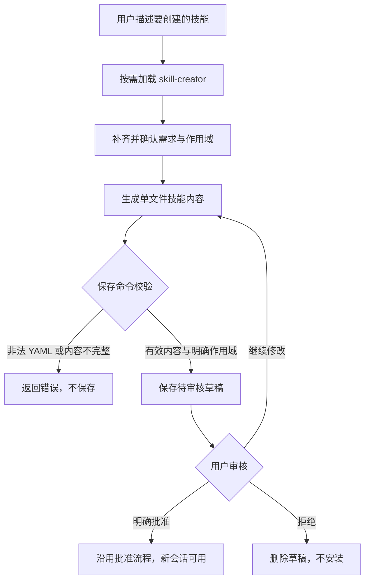

# 对话式技能创建的内核接入

需求见[规格](../specs/2026-10-19-conversational-skill-creation.md)。基于公开仓 `60892d92`；复用内置技能发现、现有 agent 对话及 `SkillDrafts`，不新增模型调用链。

## 业务流程

| 节点 | 不变量 |
| --- | --- |
| B_SAVE | `draft` 命令缺少范围、文件、有效 YAML、description 或正文时返回 `exitCode: 1`；MUST NOT 保存或安装 |
| B_DRAFT | `SkillDrafts.save` 返回 `draft: true`；MUST NOT 调用 `approve` 或改写已安装技能 |
| B_REVIEW | 仅明确批准进入既有 `approve`；重名冲突沿用原错误，MUST NOT 覆盖已安装技能 |

## 数据流

| 节点 | 不变量 |
| --- | --- |
| D_CLI | `--file` 相对 `--project` / 调用方 cwd 解析；MUST NOT 再次调用模型 |
| D_STORE | `personal` 与 `project` 沿用 `SkillManagement.root`；MUST NOT 写入另一范围 |
| D_NEW | 沿用 `sessionSkillSnapshot`；MUST NOT 重建当前会话的固定技能版本 |

## 技术裁定

1. 直接在 `src/skills/skill-loader.ts:BUILTIN_SKILLS` 注册内置定义，沿用其他内置技能的组织方式，不增加启动模块。沿用名称/描述发现和完整正文按需加载；MUST NOT 把正文写进发现列表或系统提示。对应 FR-001、B_LOAD。
2. `src/cli/skills-cli.ts:runSkillsCLI` 增加 `draft <name> --file <path> --scope personal|project [--project <absolute-path>]`。先确认目标范围，再读文件并检查 description、正文，最后调用 `SkillDrafts.save`。MUST NOT 用 `generate` 再次生成内容或直接安装。对应 FR-003、D_CLI。
3. `src/skills/skill-drafts.ts:SkillDrafts` 与 `src/server/skill-management-routes.ts:buildSkillManagementRoutes` 保持既有契约，保存可编辑同名草稿，批准重名不覆盖。MUST NOT 新建第二份草稿存储或绕过审核。对应 FR-004/005、D_STORE。
4. 创建指令解释 description 的触发用途，先补齐未确定信息、确认作用域，保存后等待审核。MUST NOT 把“请创建技能”当成自动发布授权。对应 FR-002、B_CONFIRM/B_REVIEW。

只实现上述流程、数据流和验收场景；不新增重试、缓存、降级、后台任务或泛化框架。不改变持久化实体，无需 ER 图。沿用草稿生命周期，无新增状态。

## 桌面接入（由维护者在闭源仓完成）

- 新会话输入使用 `/skill skill-creator <用户目标>`，经现有技能解析入口加载。UI 是否预填或发送由桌面实现决定；本 PR 不增加预填协议。
- 保留“直接新建”和“从资料生成”，新增“让 AI 帮我创建”入口。
- 有可执行 CLI 的环境使用新 `draft` 命令；仅打包 sidecar 的环境需接入既有 `PUT /skill-drafts/:name`，传入 `scope`、项目范围的 `cwd` 与 `content`。不得假设用户系统已安装 `rivet`，或让模型自行寻找鉴权凭据。
- 继续使用 `GET /skill-drafts`、`POST /skill-drafts/:name/approve`、`DELETE /skill-drafts/:name` 展示审核。现有鉴权保持不变。
- 桌面端到端验收需在闭源仓完成。公开仓单元/集成测试不能代替按钮、新窗口及真实模型对话验收。

## 测试矩阵与验证记录

| 场景 | 图节点 | 实现/测试入口 | 验证结果 |
| --- | --- | --- | --- |
| FR-001/002：发现、显式调用、指令契约 | B_LOAD/B_CONFIRM | src/skills/__tests__/skill-creator.test.ts | 3 项通过 |
| FR-003：范围、解析、完整性校验 | B_SAVE/D_CLI | src/cli/__tests__/skills-draft-cli.test.ts | 7 项通过（覆盖本行场景） |
| FR-004：保存/修改/拒绝/批准、会话固定版本 | B_DRAFT/B_REVIEW/D_NEW | src/cli/__tests__/skills-draft-cli.test.ts | 7 项通过（覆盖本行场景） |
| FR-005：HTTP 与 CLI 互通 | D_HTTP/D_STORE | src/cli/__tests__/skills-draft-cli.test.ts | 7 项通过（覆盖本行场景） |

2026-10-19，macOS arm64 / Node 24：

- `node --import tsx scripts/run-node-tests.ts src/skills/ src/cli/__tests__/skills-draft-cli.test.ts src/tools/__tests__/skill-tool.test.ts`：129 项通过，0 失败。
- `npm run typecheck`、`npm run build`：通过。
- 从构建后的 `dist/cli/entry.js skills` 入口，在隔离的临时项目和 `RIVET_HOME` 中执行 `draft → drafts → approve`，确认批准前未安装、批准后草稿移除且技能文件存在：通过。
- 修改文件的 oxlint：0 错误；`skill-loader.ts` 存量 `no-useless-spread` 警告未改动。`npm run docs:check` 通过，存量未公开文档引用按仓库规则跳过。
- `RIVET_TEST_CONCURRENCY=4 npm test`：1,970 个文件、23,615 项测试；23,480 通过、58 失败、76 跳过、1 todo、0 cancelled，退出码 1。56 项失败在未修改的上游独立副本中逐组复现；另 2 项是 Tab 补全子测试及父测试，全仓并发运行超出等待窗口，当前分支单独复测 10/10 通过，上游单独运行也通过。保留全仓失败结论，不把复测当成全仓通过。上游基线 `60892d92` 的 [CI 已失败](https://github.com/huiliyi37/Tianshu-harness/actions/runs/39202768543)；对未改动源码的独立副本复现了构建脚本、版本号一致性、架构/提示词预算、启动内存、agent 时序、API 网络策略、子进程中止、测试运行器与帮助目录检查的失败。启动图在基线和本改动均为 530 个模块，上限为 525；未增加启动模块或放宽检查。
- 未做真实模型多轮对话、Windows 本机、闭源桌面端到端验收；上述确定性测试验证调用与审核链路，不证明模型每次都遵守指令。Mermaid 保留可编辑源，未验证渲染。

## 设计确认

版本 1，范围已确认。2026-10-19 本次对话中，用户在看到“新增创建技能、复用草稿审核、桌面入口由作者接入”的建议后明确要求：“那就按你建议的来，先同步最新代码，把 #459 开源部分的功能实现并测试好，再帮我提交 PR，说明桌面入口需要作者接入。”具体命令命名等采用现有实现惯例；未增加新的业务范围。
